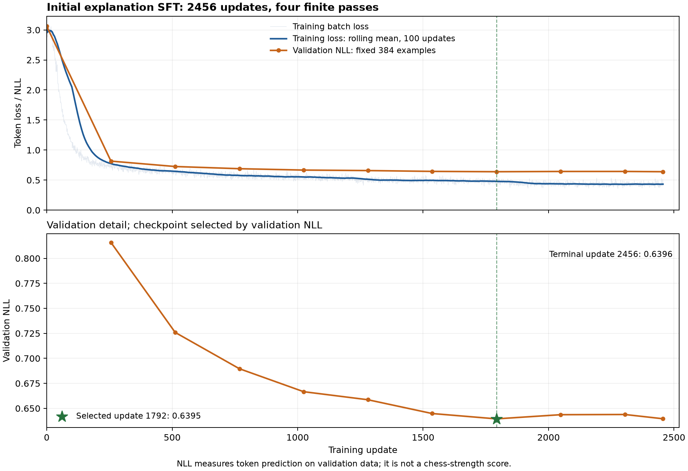

# 完整初始讲解 SFT：实际完成与接续评测

后续[384条正常组与末步对照](INITIAL_SFT_DEVELOPMENT_BASELINE.md)已完成。该完整正常组仍只有15条结构／变化线等合同有效；2456步课程复测72.50%也未超过所选1792步。以下8条训练末尾示例属于较早的小型读回。配对流程通过[完整缓存依赖与原始完成结果复用](PAIRED_RAW_REUSE.md)继续，正式蒸馏和独立验收仍待完成。

2026-11-04 22:57（UTC+8），实际四卡初始讲解训练及末尾检查完成，原拥有队列正常退出。这里只完成了初始讲解阶段，搜索蒸馏、最终独立棋力与教学验收和正式模型交付仍待完成。

后续[同设置课程复查](INITIAL_SFT_RETENTION.md)确认训前FP32对照2465/2600（94.81%）降至训后1896/2600（72.92%），存在旧任务遗忘。三组原始复查与完整逐题读回已完成；本页末尾关于当时尚未完成复查的文字保留其历史时间范围。初始SFT的内置单样本错配NLL无效，后续验证已新增整组不同历史配对。

## 实际模型与训练量

| 项目 | 实测／实际执行 |
| --- | --- |
| 父模型 | 完成的新四课所选第四课 42000 步权重 |
| 可训练参数 | 完整解码器、桥接及棋盘词元，共 4694274592 参数、624 张量 |
| 精度与并行 | FP32 主参数，BF16 计算，四卡 FSDP2；激活重计算，关闭 AMP 权重缓存 |
| 数据 | 9823 条训练、384 条验证；512 条独立测试未参与 |
| 全局／每卡微批量 | 16／1 |
| 实际更新 | 2456 次，四次有限遍历 |
| 有效呈现／分布式补齐 | 39292／4，补齐不计入有效训练量 |
| 所选检查点 | 1792 步，依据固定验证集 token NLL 选择 |
| 初始／所选验证 NLL | 3.0609198639／0.6394985969 |
| 2456 步末次验证 NLL | 0.6396112591 |
| 训练执行计时 | 19073.575 秒，包含该训练入口的末尾检查；不含此前容量门禁 |
| rank 0 的 Torch 张量峰值 | 24.8026 GiB；不是四卡最大值或驱动总占用 |

实际执行了四遍数据；所选 1792 步权重早于末步，不能把末步的全部呈现量归给所选权重。较早的连续四步对二加二原生恢复检验保持原结果，不因本次完成而重新命名为训练效果测试。

图保留全部 2456 次原始损失、100 次更新滚动平均及固定 384 条验证的原始 NLL。初始三次更新的旧快照仍是当时的历史读回。CSV 与轻量完成证据一起保存，模型参数和优化器不进入 Git。

## 讲解质量仍未通过验收

末尾 8 条固定验证示例均为可解析 JSON；其中 5 条首着合法，0 条完整通过主线、分支、候选及事实合同。发现 6 条非法主线、22 次非法分支、4 条候选错误等；这些是错误出现次数，不能相加当作不同样本数。正文还出现了把后续吃子写成“吃帅”等事实错误，全部原文保留。

这只是训练末尾的 8 条验证示例，不是完整 384 条开发评测，也不是独立测试。0/8 与“逐字等于教师参考文本”是不同指标；原有逐字比较同为 0/8，不能用它单独评判棋力。平均词元损失降低仍可能伴随关键坐标、棋子或走子次序错误，因此尚不能交付为可靠个人教练。

正常／清零专家特征的验证 NLL 为 0.63950／0.85969。内置错配数值同为 0.63950，但该验证使用单样本批次，批内循环置换恒等，未形成有效错配；这项数字不用于错配结论。后续独立运行的配对讲解开发评测采用 4 条不同历史一组，保留正常、清零、错配三组全部原始回答。

[原论文第 3.3 节](https://arxiv.org/html/2610.03695v1#S3.SS3)同样报告初始 SFT 模型仍会推荐低质量或非法走法，随后才进行搜索蒸馏。这解释了该阶段在流程中的位置，不能据此预言本项目的蒸馏收益；改进仍须实际测量。

## 课程前缀校验修复与真实读回

首次课程复查在 GPU 推理前失败：评测入口重建 SFT 合同时，没有把配方中已有的 `authorized_foundation_prefix` 传入父模型校验。第二、三课的用户指定边界因此被误当成未授权。这是评测接续错误，原训练完成记录、所选权重和原始授权证明均保留。

修复使用配方中锁定的路径与 SHA256 调用同一校验入口，仍拒绝缺失或来自另一声明的授权。新增回归用真实的受控课程前缀／完成清单重现失败，再覆盖完整配对评测及错误授权拒收。124 项相关 CPU 检查通过；真实 1792 步完整模型也已用修复入口通过 CPU 合同、完整形状与有限 FP32 检查，未初始化 CUDA。

修复后的112模块完整1906项CPU检查、构建及发布检查全部通过，299份源码／测试／配置／构建文件身份一致；这不代替实际GPU推理容量和模型质量评测。

实际 SFT 始终使用原来的 109 模块冻结消费者，其源码归档和 1790 项完整检查保持原身份。修复后的评测消费者是另行冻结的 112 模块；当前软件修复没有改写已经完成的训练来源。

## 后续工作与运行定位

新的课程复查拥有者位于`runs/pinned-base-post-sft-replay-v8/auto-initial-replay`，后续串行拥有者位于`runs/post-sft-full-bf16-development-v2`。本次记录时课程复查状态为`invoking_actual_post_sft_curriculum_validation`，尚未产生完成成绩。原v7复查及v1开发等待器的失败均保留，SFT原拥有者正常退出；当前模型没有因此重训。

接续按三组 2600 题四课复查、三组 384 条讲解与完整 BF16 教师辅助评审、384 局开发对弈、512 根真实搜索产量试批的顺序运行。完整教师沿用原未量化 BF16 权重，四卡张量并行；新的实际推理容量和产出率仍由真实运行建立。

正式搜索规模和蒸馏轮数依据实际产量、错误和开发收益确定。所有开发选模结束后才锁定模型并使用保护的独立测试集，最后导出实际模型、搬动验证并运行教练入口；完整项目目标保持未完成。
