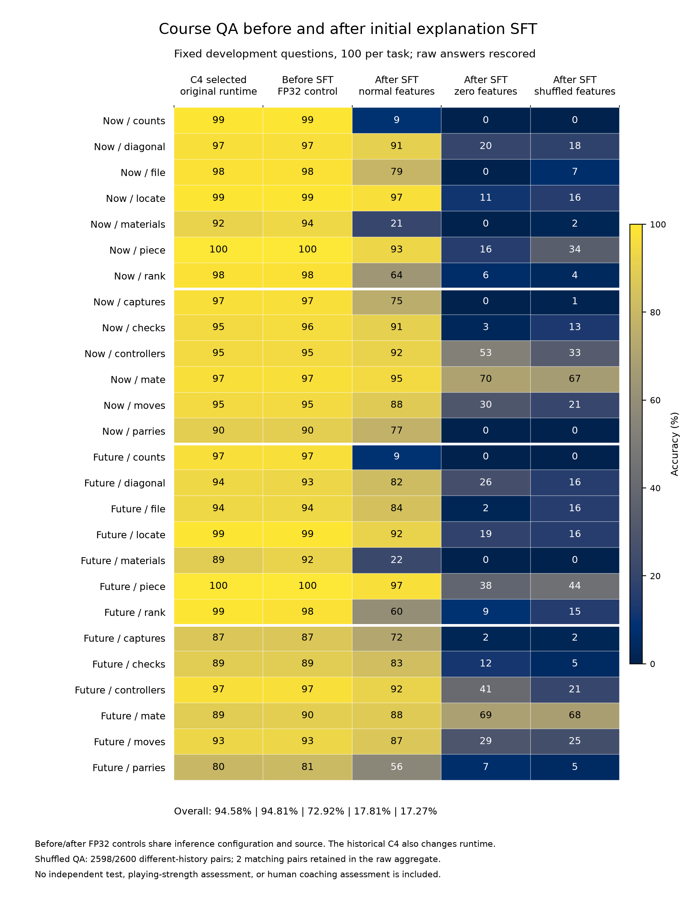

# 初始讲解后的课程能力：同设置对照与错配诊断

2026-11-05（UTC+8），实际选中1792步的初始讲解模型在原2600道课程开发题上得到1896/2600（72.92%）。用讲解前完整FP32参数、相同推理源码及配置重测为2465/2600（94.81%），净少569题。题目、问法、顺序、金标及评分规则逐条一致，确认讲解微调后的旧任务遗忘。对弈棋力和人类教学质量须另行评测。

## 对照实际比较了什么

训前快照来自真实全模型容量检验的零更新状态，包含原四课所选桥接／棋盘参数和原基础解码器。624个FP32张量、4694274592个参数与诊断重导出逐值相等；只将容量探针的运行元数据对齐为正式推理配置，没有执行优化器更新。训前、训后推理仅替换模型文件及输出位置。

| 范围 | 训前FP32对照 | 训后1792步正常特征 |
| --- | ---: | ---: |
| 当前静态 | 685/700（97.86%） | 454/700（64.86%） |
| 当前动态 | 570/600（95.00%） | 518/600（86.33%） |
| 未来静态 | 673/700（96.14%） | 446/700（63.71%） |
| 未来动态 | 537/600（89.50%） | 478/600（79.67%） |
| 合计 | 2465/2600（94.81%） | 1896/2600（72.92%） |

同题中599道由对转错，30道由错转对。训后704道错误中191道格式无效，另外513道格式有效但内容错误；原始回答保持，未从正文提取正确片段替换最后答案，也未放宽评分。当前／未来数子分别99%／97%降为9%／9%，子力总值94%／92%降为21%／22%。

原第四课历史运行是2459/2600（94.58%）。它与本次训前FP32对照还存在历史推理实现等差别，二者净多6题不能全部归因于精度；判断讲解微调影响采用同一当前推理实现的2465对1896。

[数值CSV](../evidence/initial-sft-retention-v1/task-accuracies.csv)和[SVG](../evidence/initial-sft-retention-v1/retention.svg)可单独下载。图及[轻量证据](../evidence/initial-sft-retention-v1.json)来自13000份原始回答的再次评分：同2600题、五组模型／特征条件，并非13000道独立问题。

## 模型仍使用专家特征

| 训后特征条件 | 正确题数／2600 | 正确率 |
| --- | ---: | ---: |
| 正常 | 1896 | 72.92% |
| 清零 | 463 | 17.81% |
| 原批内循环错配 | 449 | 17.27% |

本次课程错配沿原评测入口执行。实际核对发现2598对来自不同历史，2对仍为同一历史；原2600题聚合保持，2598道真正不同历史子集为447/2598（17.21%）。不能把整组称为2600对全部不同历史，也不将低分称为随机猜测水平。后续384条讲解配对验证具有384条不同历史。

## 修复训练末尾的无效单样本错配

初始SFT内置验证使用`eval_batch_size=1`，旧实现在每个批次内轮换特征，实际没有更换输入；其错配NLL与正常NLL相同，不支持任何有效错配结论。既有训练、原数值及所选参数保持原记录。

新的训练验证在整组验证样本上安排不同历史，再按原批量计算损失；单样本批次和尾部单样本都获得另一段历史。重复历史按组分配，保持每条特征的原有出现次数；无法为全部样本安排不同历史时明确拒绝。题目、答案、正常与清零验证及训练随机序列保持。

新增14项回归在修复前10项失败、4项通过，修复后146项相关检查通过；1920项完整CPU测试通过。另用真实384条讲解验证缓存核对，全部384对的16层实际BF16特征均不同，没有执行神经网络或训练。修正后的真实模型NLL若已实测，另列在本页后续实测记录与轻量证据中；缓存检查本身不提供模型损失或能力结论。

实际初始SFT始终使用原109份冻结源码；本次软件修复供后续验证使用，没有改写已经完成的训练来源。正在执行的三组讲解生成仍使用其原112模块冻结来源。

### 实际完整模型的修正后损失

同一1792步完整模型已在原384条讲解验证题、原单样本批量下重新完成三组共1152次前向评估：正常NLL为0.6394985969，清零为0.8596881261，真正错配为1.0090401566。正常与清零数值和原正式SFT记录完全一致；错配使用384对全部16层都不同的实际特征。

模型文件前后SHA256保持原值，没有训练、生成标签或改变选模。本项为讲解标签的词元损失检查，不能替代原始讲解事实核验或对弈。完整运行在`runs/global-validation-memory-shuffle-v1/native-nll-v1`。

## 后续与复查路径

原始训前2600题输出保存在`runs/initial-sft-retention-control-v2/before-normal`。原CPU收尾漏用了已有核验会话，开始重复读取多TB特征缓存；确认模型子进程已经退出后仅退役该自有CPU收尾，在`runs/initial-sft-retention-control-v3-readback`内用原有效凭据完成核验，并重新比较全部624个实际张量。没有重复GPU生成，也没有宣称本次重新读取了整库字节。

完整独立读回在`runs/initial-sft-retention-readback-v2`；采用原始字节证明和持续未变文件身份核验大缓存，所有模型、回答及聚合绑定仍检查。首版读回等待器退役记录和旧诊断输出均保留。

同一模型的三组384条讲解、384局开发对弈和512根真实搜索产量试批继续执行。另行复查实际2456步末次权重，检查讲解选模位置是否影响旧能力；该诊断没有替换当前1792步模型。后续依据完整开发结果评估旧课混合回放等改进，尚未开始新的保持能力训练或正式蒸馏轮次。完整教练模型及最终独立验收仍待完成。
